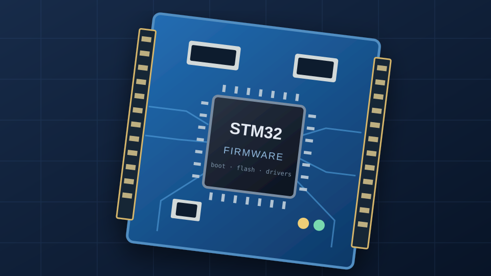

<!DOCTYPE html>
<html lang="en">
<head>
  <meta charset="UTF-8" />
  <meta name="viewport" content="width=device-width, initial-scale=1" />
  <meta name="description" content="Henry Hung — Electrical Engineering student focused on embedded systems, firmware, and low-level software." />
  <meta name="theme-color" content="#0b1220" />
  <title>Henry Hung | Embedded Systems & Firmware</title>
  <link rel="icon" type="image/svg+xml" href="assets/favicon.svg" />
  <link rel="stylesheet" href="style.css" />
</head>
<body>
  

    <header class="site-header">
      <a class="brand" href="#home" aria-label="Henry Hung — Home">
        H.
        Henry Hung
      </a>
      <nav aria-label="Main navigation">
        <a href="#about">About</a>
        <a href="#projects">Projects</a>
        <a href="#contact">Contact</a>
      </nav>
    </header>

    <main id="home">
      <section class="hero" aria-labelledby="hero-title">
        
 ELECTRICAL ENGINEERING · UNIVERSITY OF WATERLOO

        <h1 id="hero-title">Embedded Systems &amp; Firmware.</h1>
        

          I build software close to the hardware — from microcontroller firmware
          to RISC-V operating systems and device drivers.
        

        

          <a class="button button-primary" href="#projects">Explore projects ↗</a>
          <!-- Replace YOUR_USERNAME with your GitHub username. -->
          <a class="button button-outline" href="https://github.com/YOUR_USERNAME" target="_blank" rel="noopener noreferrer">GitHub profile ↗</a>
        

      </section>

      <section class="projects section" id="projects" aria-labelledby="projects-title">
        

          

            
SELECTED WORK

            <h2 id="projects-title">Featured projects.</h2>
          

          
Hardware, software, and everything in between.

        

        

          <article class="project-card">
            

              
              01 / OPERATING SYSTEMS
            

            

              
RISC-VCOS DEVELOPMENT

              <h3>xv6 on Allwinner D1</h3>
              
Bringing the xv6 teaching operating system to a real RISC-V board, including memory mapping, UART bring-up, and low-level device support.

              <!-- Replace href with the corresponding project repository. -->
              <a class="project-link" href="https://github.com/YOUR_USERNAME" target="_blank" rel="noopener noreferrer">View on GitHub ↗</a>
            

          </article>

          <article class="project-card">
            

              
              02 / EMBEDDED FIRMWARE
            

            

              
STM32CFIRMWARE

              <h3>STM32 Firmware &amp; Drivers</h3>
              
Firmware update workflows, flash partition handling, and embedded communication drivers spanning I²C, RS-485, and CAN.

              <a class="project-link" href="https://github.com/YOUR_USERNAME" target="_blank" rel="noopener noreferrer">View on GitHub ↗</a>
            

          </article>
        

      </section>

      <section class="about section" id="about" aria-labelledby="about-title">
        

          
A LITTLE ABOUT ME

          <h2 id="about-title">Curious about what happens under the hood.</h2>
        

        

          
I'm an Electrical Engineering student at the University of Waterloo with an interest in embedded software, computer architecture, and hands-on hardware development.

          
I enjoy understanding systems from the register level up — building drivers, debugging peripherals, and figuring out how operating systems interact with real hardware.

          

            Embedded C/C++STM32RISC-VLinuxRTOSPCB Design
          

        

      </section>

      <section class="contact section" id="contact" aria-labelledby="contact-title">
        
GET IN TOUCH

        <h2 id="contact-title">Have something in mind?</h2>
        
I'm always interested in embedded systems, firmware, and hardware-software projects.

        

          <!-- Replace with your actual email address. -->
          <a class="button button-primary" href="mailto:YOUR_EMAIL@example.com">Email me ↗</a>
          <a class="button button-outline" href="https://github.com/YOUR_USERNAME" target="_blank" rel="noopener noreferrer">Find me on GitHub ↗</a>
        

      </section>
    </main>

    <footer class="site-footer">
      © 2026 Henry Hung
      Built with HTML &amp; CSS · Hosted on GitHub Pages
    </footer>
  

  
</body>
</html>
